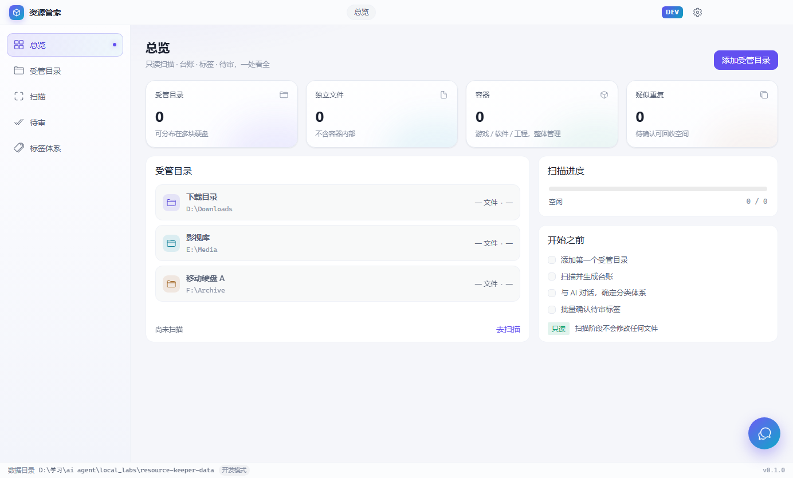
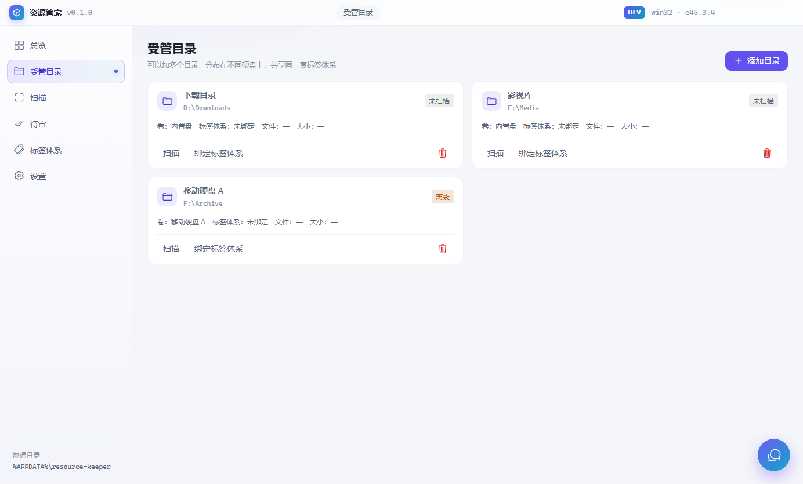
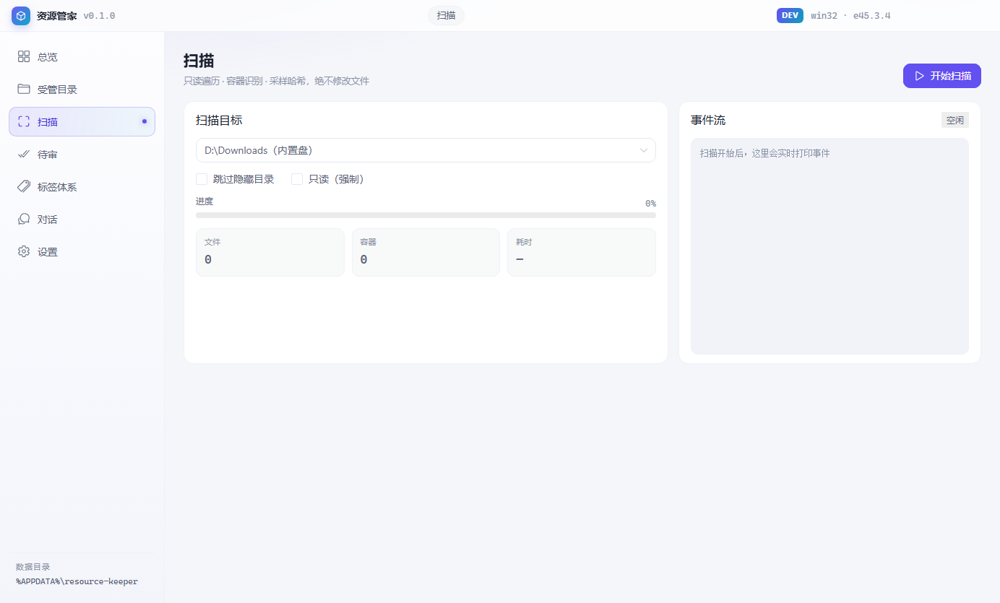
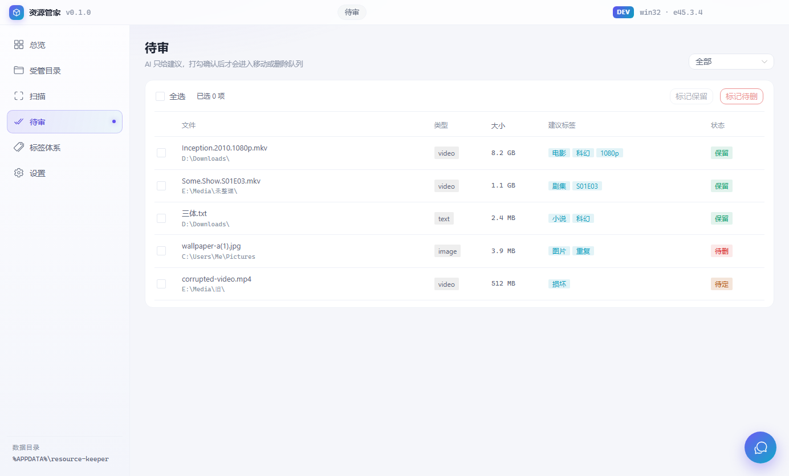
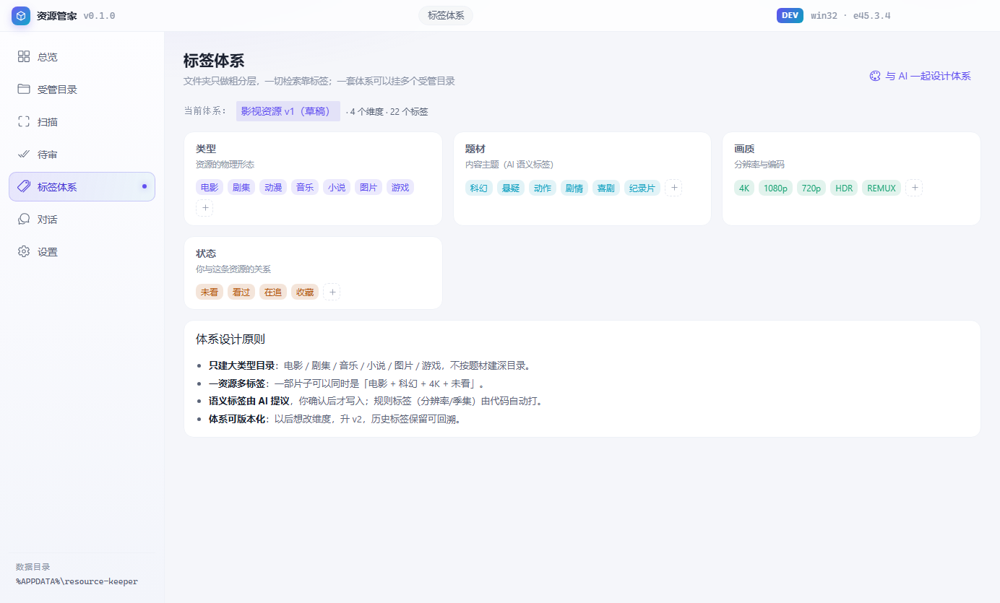
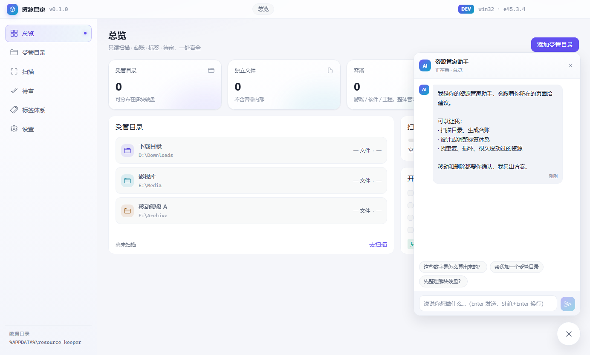

# 资源管家 · Resource Keeper

把散落在**多块硬盘**里的影视、剧集、小说、图片、游戏等资源，整理成**一套统一的台账 + 标签体系**，并让 AI 帮你出方案、你只负责点头。

> 一句话定位：**AI 提建议、程序做核对、你按确认键**。任何移动、删除动作都不会自己发生。

---

## 现在到哪一步了

当前是 **阶段 0：界面骨架**。所有页面、导航、视觉体系、IPC 通道都已跑通，数据是占位数据；模型接入的配置层（阶段 2 的前半）已经就位，对话本身还没接。

- ✅ Electron + Vue 3 + TS + Sass 骨架，构建 / 类型检查通过
- ✅ 5 个页面 + 设置弹窗：总览、受管目录、扫描、待审、标签体系；设置是盖在窗口上的浮层，不占路由
- ✅ 模型接入：多家提供商并存可切，密钥 DPAPI 加密落盘，带连通性测试、模型目录与「获取可用模型」
- ✅ 悬浮助手：右下角常驻，任意页面唤起，话术随当前页面切换（当前只有 UI，未接模型）
- ✅ 主进程 / 渲染进程 IPC 通道搭好（`app:info`、`db:overview`、窗口控制）
- ⬜ 真实扫描（文件遍历、容器识别、哈希采样）
- ⬜ SQLite 台账（`data/keeper.db`）
- ⬜ AI 对话与标签建议
- ⬜ Go sidecar（大批量文件操作用）

---

## 界面

| 总览 | 受管目录 |
|---|---|
|  |  |

| 扫描 | 待审 |
|---|---|
|  |  |

| 标签体系 | 悬浮助手（任意页面可唤起） |
|---|---|
|  |  |

设置弹窗见 [提供商列表](docs/screenshots/settings.png) 与 [行内编辑面板](docs/screenshots/settings-model.png)。

---

## 技术选型与理由

| 层 | 选型 | 为什么 |
|---|---|---|
| 桌面容器 | **Electron** | 你熟；跨 Win/mac/Linux；`contextIsolation + preload` 能给渲染层最小权限 API，避免把 `fs` 直接暴露给页面 |
| 前端框架 | **Vue 3 + TypeScript** | 你熟；组合式 API 写交互（扫描进度、对话流）比选项式清楚；TS 让 IPC 的请求/响应结构在编译期就能对齐 |
| 样式 | **Sass + CSS 变量** | 设计令牌（颜色/间距/圆角）集中在 `_tokens.scss`，后面换主题只改一处 |
| 组件库 | **Naive UI** | 原生 TS 支持最好、主题变量开箱即用（当前走亮色基线）、不需要额外样式文件注入；表格/表单/树这些重组件齐全，且体积比 Element Plus 小 |
| 构建 | **electron-vite** | 主进程/preload/渲染进程三套构建一次配好，HMR 直接可用，打包产物结构和 electron-builder 天然对齐 |
| 状态 | **Pinia** | 受管目录、扫描会话、标签体系都是跨页面共享状态，集中放 store 比 props 层层传干净 |
| 路由 | **vue-router（hash 模式）** | Electron 里用 `file://` 加载页面，hash 路由不需要配置 history fallback |
| 打包 | **electron-builder** | 出免安装 zip / NSIS 安装包 / dmg；开源发 GitHub Release 直接用 |
| 文件重活 | **Go sidecar（后续）** | 百万级文件遍历、批量移动改名，Node 的 `fs` 太慢；Go 单二进制塞进 `resources/bin/` 即可，不要求用户装环境 |
| 数据 | **SQLite（`data/` 目录）** | 全本地、单文件、可随项目走；不上任何远程服务 |

**不开源就不做**的三个前提也守住了：全部本地、无额外环境、拉下来 `npm i && npm run dev` 就能启动。

---

## 目录结构

```
resource-keeper/
├── src/
│   ├── main/index.ts          # 主进程：窗口、IPC、后续扫描调度
│   ├── preload/               # 渲染层唯一的 API 出口（contextBridge）
│   └── renderer/
│       ├── index.html
│       └── src/
│           ├── App.vue        # 布局外壳：标题栏 / 侧栏 / 内容区
│           ├── router/        # 页面路由
│           ├── styles/        # _tokens.scss 设计令牌 + main.scss 全局样式
│           ├── components/    # AppTitlebar / AppSidebar / AppAssistant / SettingsDialog / StatCard
│           └── views/         # 5 个页面
├── scripts/check-layout.cjs   # 开发用：Electron 实测布局尺寸 + 逐页截图
├── electron.vite.config.ts
├── electron-builder.yml
└── package.json
```

---

## 开发命令

```bash
npm install          # 或 pnpm install
npm run dev          # 开发模式，带 HMR
npm run typecheck    # 主进程 tsc + 渲染层 vue-tsc
npm run build        # typecheck + 三端构建，产物在 out/
npm run start        # 预览构建产物
npm run pack         # 免安装目录包（out 到 dist/）
npm run dist         # 安装包
```

### 布局自检（开发时用）

```bash
# 1. 构建后把渲染产物起成本地静态服务
cd out/renderer && python -m http.server 8756
# 2. 另开一个终端，在项目根目录
SHOT_BASE=http://127.0.0.1:8756/ SHOT_PAGES=dashboard,libraries,scan \
  ./node_modules/electron/dist/electron.exe --no-sandbox scripts/check-layout.cjs
# 结果：案例目录下 layout-report.json（每页元素真实尺寸 + 溢出检测）+ shot-*.png
```

这个脚本直接读浏览器算出来的 `getBoundingClientRect` / `scrollHeight`，比截图肉眼判断可靠。

---

## 设计原则（写进代码里的约束）

1. **扫描只读**：扫描阶段绝不改任何文件，只生成台账。
2. **AI 只提议**：模型输出的是「建议标签 / 建议路径」，写入前必须过规则校验。
3. **危险动作必确认**：移动、删除进待审队列，你勾选后才执行。
4. **多目录一套体系**：受管目录可以跨硬盘，标签体系只有一套，随时可加。
5. **容器整体管理**：游戏、软件、工程这类「一个目录就是一个整体」的，识别为容器，不拆散。
6. **离线可降级**：没配模型就走规则模式，功能不瘫。

---

## 路线图

| 阶段 | 目标 |
|---|---|
| 0 | 界面骨架（当前） |
| 1 | 真实扫描 + SQLite 台账 + 总览真实数据 |
| 2 | 模型接入、AI 对话定分类体系、标签建议 |
| 3 | 待审队列执行移动/删除（含 dry-run 预览） |
| 4 | Go sidecar 加速、重复文件视觉去重 |
| 5 | 打包发布、开源 |

---

MIT License